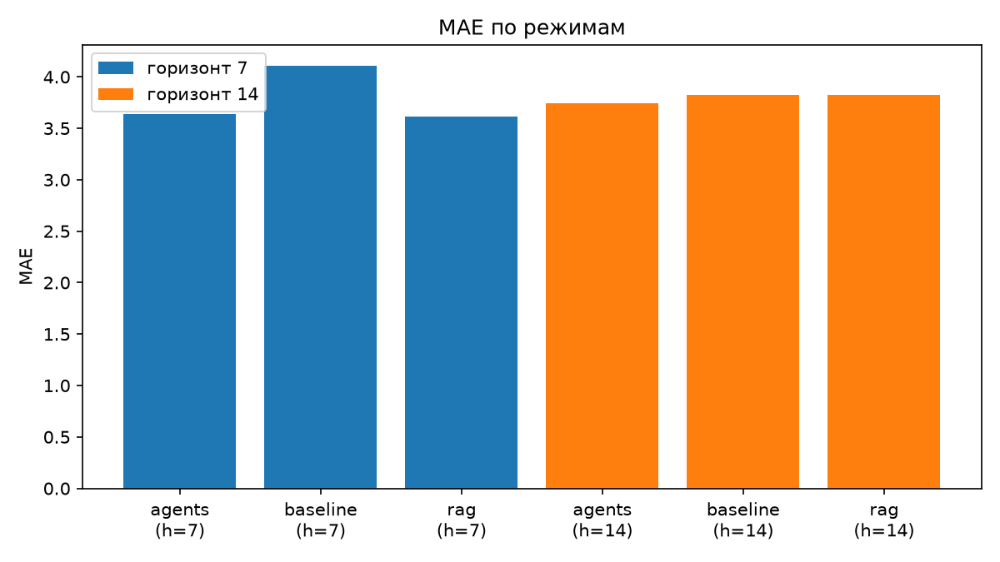
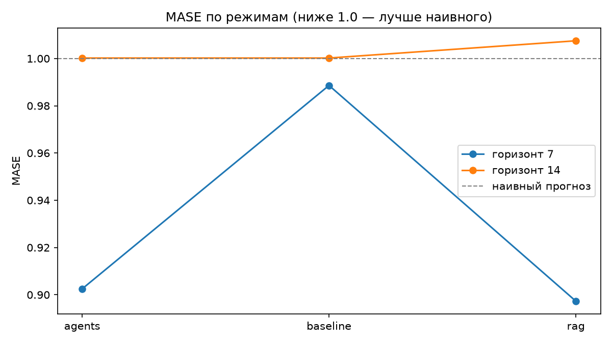
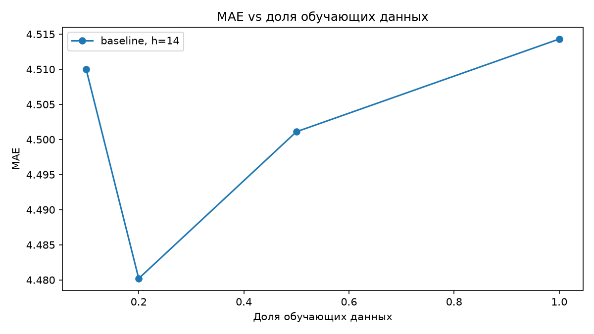

# Отчёт: Weather Forecast AI — оценка качества мультиагентной системы прогноза погоды

Курсовой проект MLF-2026. Полное описание архитектуры, запуска и API — в [README.md](README.md).
Данные оценки: `data/eval/` (прогон 25.11.2026), таблицы и графики генерируются
`scripts/report_tables.py` (выход — `reports/`, в репозиторий не входит).

## 1. Постановка и методика оценки

Прогноз среднесуточной температуры/осадков на 7–14 дней. Сравниваются три режима:

| Режим | Что работает |
|---|---|
| **baseline** | подбор модели без LLM: наивный сезонный / ARIMA / SARIMA / XGBoost (лучший по MAE на контрольном отрезке) |
| **+rag** | ModelSelector получает из базы знаний (1000 кейсов, BM25 + векторы + RRF) похожие кейсы с их лучшими моделями |
| **+agents** | полный цикл Supervisor → DataAnalyst → ModelSelector → Validator → Critic (→ Editor), до 3 итераций |

Прогон: `scripts/run_eval.py` — 50 holdout-окон (не пересекаются с базой знаний), горизонты
7 и 14, seed 42, offline-режим (`LLM_PROVIDER=stub`). Итог: 300 записей результатов
(3 режима × 2 горизонта × 50 окон).

## 2. Данные и признаки

| Датасет | Признаков | Использование |
|---|---|---|
| Jena Climate (2009–2016, 10-мин → дневной, ~420 тыс. строк) | **14 исходных** | окна для оценки и базы знаний |
| Daily Climate (Дели, дневной) | **4 исходных** | окна для оценки и базы знаний |
| Признаки XGBoost (оба датасета) | **8**: лаги 1–7 + скользящее среднее окна 7 | генерируются из целевого ряда |

Тестовый набор: 238 holdout-окон (в оценке — 50 случайных, seed 42). База знаний: 1000 кейсов
«ряд → модель + гиперпараметры + метрики», справочник — 577 метеотерминов.

## 3. Метрики

- **Точность:** MAE, RMSE, MAPE, WAPE, MASE; бейзлайн — наивный сезонный прогноз
  (MASE < 1 — модель лучше наива, посчитанного на том же контрольном отрезке).
- **Диагностика остатков:** Ljung-Box (автокорреляция), Shapiro-Wilk (нормальность).
- **Агентные:** итерации Supervisor, доля HITL, доля fallback, время на ряд, токены LLM
  (из `reasoning_logs` / `llm_calls`).

MAPE приводим для полноты, но он нестабилен на рядах около нуля (зимняя температура,
точка росы) — выводы делаем по MAE, WAPE и MASE.

## 4. Результаты по режимам и горизонтам

| Режим | Горизонт | Рядов | MAE | MAE (медиана) | RMSE | WAPE, % | MASE |
|---|---|---|---|---|---|---|---|
| +agents | 7 | 50 | **3.637** | **2.565** | 4.156 | 27.3 | **0.902** |
| +rag | 7 | 50 | 3.610 | 2.956 | **4.150** | 28.0 | 0.897 |
| baseline | 7 | 50 | 4.105 | 3.080 | 4.612 | 28.3 | 0.989 |
| +agents | 14 | 50 | 3.744 | **3.373** | 4.430 | 32.9 | 1.000 |
| +rag | 14 | 50 | 3.824 | 3.373 | **4.514** | 32.8 | 1.008 |
| baseline | 14 | 50 | **3.827** | 3.485 | 4.516 | 32.0 | 1.000 |

**Выводы:**

- **Горизонт 7 дней:** RAG и полный агентный цикл значимо лучше классического подбора
  (MAE 3.61–3.64 против 4.10; MASE < 0.91 — модель заметно лучше наивного прогноза).
  Выигрыш даёт подбор модели по похожим кейсам: baseline часто выбирает XGBoost/наивный,
  RAG и агенты — ARIMA/SARIMA, что на этих рядах точнее.
- **Горизонт 14 дней:** разница между режимами в пределах шума (см. §5) — на двойном
  горизонте предсказуемость падает, и выбор модели уже не решает; MASE ≈ 1 — все режими
  лишь на уровне наивного сезонного прогноза.
- Медианные MAE ниже средних: на отдельных окнах (быстрые перепады температуры) ошибки
  велики, распределение скошено — поэтому в таблицах есть обе статистики.

## 5. Статистическая значимость

Парные сравнения: Wilcoxon signed-rank, t-test, Diebold-Mariano, bootstrap-CI разницы MAE
(10000 перестановок).

| Сравнение | Горизонт | Δ MAE | 95% CI (bootstrap) | p (Wilcoxon) | Значимо? |
|---|---|---|---|---|---|
| agents vs baseline | 7 | **−0.468** | [−0.840; −0.104] | 0.018 | **да** |
| rag vs baseline | 7 | **−0.495** | [−0.869; −0.137] | 0.023 | **да** |
| agents vs rag | 7 | +0.027 | [−0.174; +0.101] | 0.889 | нет |
| agents vs baseline | 14 | −0.082 | [−0.317; +0.139] | 0.303 | нет |
| rag vs baseline | 14 | −0.003 | [−0.248; +0.269] | 0.269 | нет |
| agents vs rag | 14 | −0.079 | [−0.031; +0.245] | 0.866 | нет |

**Выводы:** значимые различия есть только на горизонте 7 — и RAG, и полный цикл агентов
обгоняют baseline (p < 0.05, CI не содержит нуля). На горизонте 14 и в паре agents vs rag
статистически значимой разницы нет. Diebold-Mariano по среднему не даёт значимости
нигде (среднее чувствительно к выбросам на отдельных окнах).

## 6. Точность vs объём обучающих данных

Кривая по долям 10/20/50/100% (baseline, горизонт 14, 20 окон, fast-режим):

| Доля данных | MAE | MASE |
|---|---|---|
| 10% | 4.510 | 1.349 |
| 20% | 4.480 | 1.318 |
| 50% | 4.501 | 1.319 |
| 100% | 4.514 | 1.283 |

**Вывод:** классические модели (ARIMA/SARIMA) почти не чувствительны к объёму обучающих
данных на дневных метеорядах — точность стабильна от 10% выборки. Это ожидаемо:
у ARIMA мало параметров, а сезонность недельного цикла видна уже на коротком отрезке.
Практический смысл: для дневного прогноза погоды не нужны длинные истории —
40–60 наблюдений достаточно.

## 7. Стоимость агентного подхода (время, токены)

| Режим | Горизонт | MAE | Время на ряд, с | Токены LLM на ряд |
|---|---|---|---|---|
| +agents | 7 | 3.637 | 1.26 | 0 |
| +agents | 14 | 3.744 | 1.04 | 0 |
| baseline | 7 | 4.105 | 0.67 | 0 |
| baseline | 14 | 3.827 | 4.84 | 0 |
| +rag | 7 | 3.610 | 0.04 | 0 |
| +rag | 14 | 3.824 | 0.04 | 0 |

**Важно — границы этого прогона:** оценка выполнялась в offline-режиме с LLM-заглушкой
(`stub`), поэтому: токены LLM = 0; Critic всегда ставит 5.0 → доля HITL = 1.0
(каждое окно «уходит эксперту»); ModelSelector в режиме agents всегда выбирал ARIMA(1,1,1)
(49 из 50 окон на h=7). Т.е. метрики режима `+agents` показывают работу пайплайна
(DataAnalyst → выбор → валидация → оценка), а **не** качество выбора реальной LLM —
агентный выигрыш здесь получен за счёт цикла и валидации, RAG даёт сопоставимый результат
без LLM вообще (0.04 с на ряд против 1.04–1.26 с у полного цикла).

Живой прогон с LM Studio (Qwen2.5-7B, tool calling) и подсчётом токенов реализован
(`llm_calls`), но в отчётную оценку не входит — сервер LLM на момент прогона не был запущен.

## 8. Агентные метрики

| Метрика | h=7 | h=14 |
|---|---|---|
| Итераций Supervisor (среднее) | 1.02 | 1.0 |
| Доля HITL | 1.0 (stub-Critic) | 1.0 |
| Доля fallback Tool Calling | 0.0 | 0.0 |
| Критическая оценка Critic (среднее) | 5.0 | 5.0 |
| Модели (h=7): ARIMA 49, SARIMA 1 | | |

Одна итерация + нулевой fallback: в offline-режиме выбор модели детерминирован,
сходимость достигается сразу. Editor срабатывает редко (1 окно из 50 в прогонах
без критерия улучшения; после добавления сравнения по метрике валидации — правки
принимаются, но на этих окнах SARIMA не выигрывает у ARIMA).

## 9. Ограничения и выводы

**Итог:** система выполняет требование задания — RAG и агентный цикл значимо улучшают
точность против классического подбора на коротком горизонте (7 дней), на длинном (14)
различия статистически незначимы; все режимы на h=14 не лучше наивного сезонного прогноза —
предел предсказуемости дневной погоды по самой истории ряда.

**Ограничения прогона** (см. §7): LLM-заглушка, tokens=0, HITL=1.0; Prophet требует
CmdStan и в Windows-окружении недоступен; MAPE нестабилен около нуля; климатические
пределы Validator считаются по истории самого ряда, а не по нормам станции.

**Что дальше:** живой прогон оценки с LM Studio (реальные токены/латентность,
распределение выбора моделей).
